<div align="center">

# 🌌 Orbital Loom X — الرحلة المجرية

**خلفية حية تفاعلية لبرنامج [Lively Wallpaper](https://github.com/lively-community/lively) على ويندوز**
**An interactive live wallpaper for [Lively Wallpaper](https://github.com/lively-community/lively) on Windows**

المجموعة الشمسية تنسج مسارات حلزونية وهي تسافر عبر مجرة درب التبانة. تُحسب الحركة رياضياً على كرت الشاشة (WebGL2).
*The Solar System weaving helical paths as it voyages through the Milky Way. The motion is computed on the GPU with WebGL2.*

[](https://github.com/r3dmof3-cyber/Orbital_Loom_X/raw/main/release/Orbital_Loom_X_Galactic_Voyage.zip)
[](https://r3dmof3-cyber.github.io/Orbital_Loom_X/)
[](LICENSE)

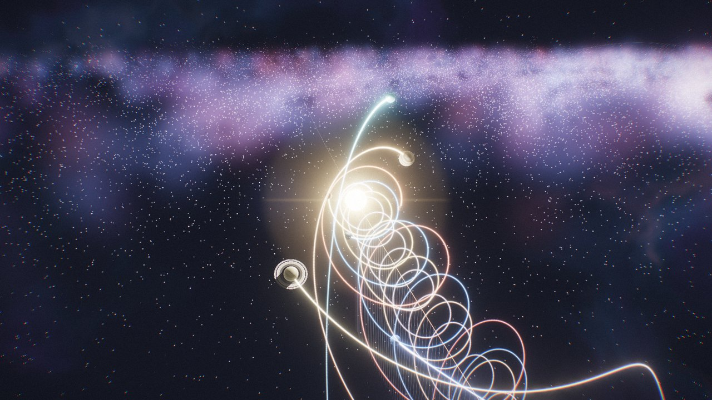

**برمجة وتصميم: يوسف أنور الكمالي — Yousif Anwar Alkmali — r3dmof3@gmail.com**

</div>

---

## 🆕 الجديد في الإصدار 2.0

| | |
|---|---|
| 🌠 **ست قصص كونية جديدة** | النجم الطارق (النابض)، ترابيست-1، كيلونوفا، ثلاثة ثقوب سوداء، العملاق TON 618، موكب الأحجام |
| 📱 **واجهة للهاتف** | عند فتح الموقع من الهاتف يتغير التصميم إلى وضع عمودي، مع شريط مشاهد سفلي ولمس وتقريب بإصبعين |
| 🔊 **نظام صوت** | صوت محيطي يتغير مع كل مشهد، وطَرْق النابض بتردده الحقيقي، وصوت اندماج النجمين. كله مولَّد برمجياً بدون ملفات صوت |
| 👁 **زر العين** | يخفي الأدوات: الواجهة كاملة ← الشرح فقط ← المشهد فقط |
| 🎬 **تصدير صورة وفيديو** | صورة PNG حتى 4K، أو فيديو لعدة مشاهد متتالية مع الشرح والصوت، أفقي أو عمودي (Reels) أو مربع |
| ⚡ **أداء وسرعة** | أداء تلقائي يضبط الدقة للحفاظ على السلاسة، ودعم حتى 4K، ورسم الثقب الأسود في منطقته فقط |
| 🖥️ **نسختان** | نسخة الويب فيها كل الأدوات. ونسخة سطح المكتب فيها العين والصوت، وإعداداتها من Customize في Lively |

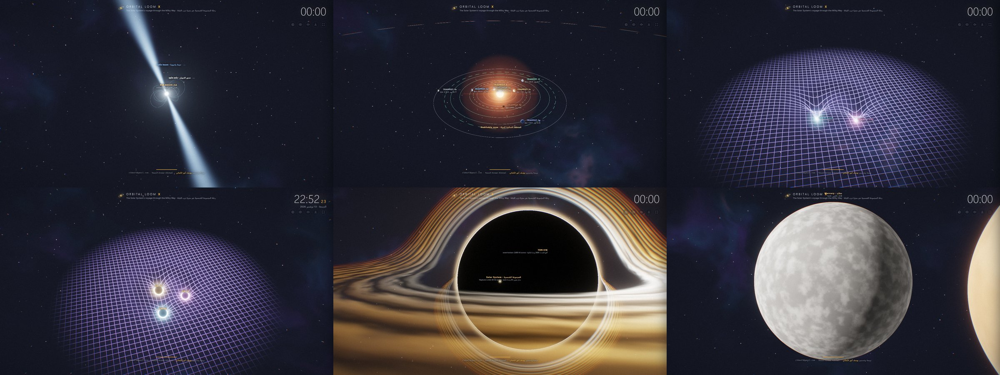

### 🪐 كواكب بتفاصيل عالية (2.2)
عند الاقتراب من أي كوكب تزيد تفاصيل سطحه تلقائياً: فوهات عطارد والمريخ بتضاريس وظلال حقيقية، وقارات الأرض وجبالها وغيومها وأضواء مدنها، وأحزمة المشتري وبقعته الحمراء، وحبيبات سطح الشمس وبقعها. كل ذلك مرسوم برمجياً بدون صور، فيبقى حاداً بأي دقة حتى 4K.

خيار **دقة العرض** الجديد: تلقائي (حسب الشاشة وكرت الشاشة) أو 720p أو 1080p أو 1440p أو 4K.

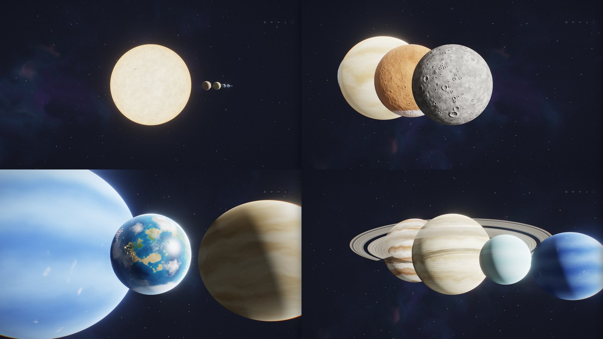

### نسخة الويب ونسخة سطح المكتب

| الميزة | 🌐 الموقع المباشر | 🖥️ خلفية Lively (ZIP) |
|---|---|---|
| كل المشاهد والقصص الـ 14 | ✅ | ✅ |
| المخرج السينمائي التلقائي | ✅ | ✅ |
| الإعدادات | لوحة ⚙ على الشاشة | Customize في Lively |
| الصوت | ✅ زر 🔊 | ✅ زر 🔊 أو خيار "الصوت" في Customize |
| تصدير صورة وفيديو | ✅ | — |
| زر العين 👁 | ✅ | ✅ |
| ملء الشاشة | ✅ | — |
| واجهة الهاتف | ✅ | — |

### 📱 على الهاتف
افتح **https://r3dmof3-cyber.github.io/Orbital_Loom_X/** من متصفح الهاتف. اسحب بإصبع لتدوير الكاميرا، وقرّب بإصبعين، واختر المشهد من الشريط السفلي.

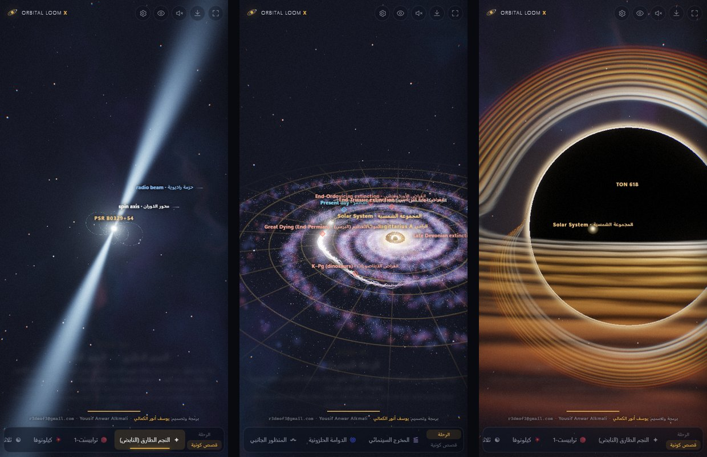

### 🎬 التصدير (نسخة الويب)
اضغط زر التصدير ⬇ في شريط الأدوات (أو حرف `E`)، ثم اختر:
- **النوع:** صورة PNG أو فيديو.
- **الدقة:** 1080p أو 1440p أو 4K.
- **الشكل:** أفقي 16:9، أو عمودي 9:16 للريلز، أو مربع.
- **المشاهد ومدة كل مشهد:** لعمل فيديو علمي من عدة مشاهد متتالية.
- **الشرح والأسماء والصوت:** تُضاف على الفيديو نفسه.

> يُسجَّل الفيديو بالزمن الحقيقي، فأبقِ الصفحة ظاهرة حتى ينتهي. الصيغة MP4 في المتصفحات التي تدعمها، وإلا WebM. دقة 4K تحتاج كرت شاشة قوياً.

---

## 📥 التثبيت والتشغيل (عربي)

### الطريقة 1: ملف ZIP (موصى بها)
1. ثبّت **Lively Wallpaper** مجاناً من [Microsoft Store](https://apps.microsoft.com/detail/9ntm2qc6qws7) أو من [GitHub](https://github.com/lively-community/lively/releases).
2. حمّل الملف: **[Orbital_Loom_X_Galactic_Voyage.zip](https://github.com/r3dmof3-cyber/Orbital_Loom_X/raw/main/release/Orbital_Loom_X_Galactic_Voyage.zip)**. لا تفك الضغط.
3. افتح Lively واضغط زر **➕ Add Wallpaper**، ثم **Choose a file** واختر ملف ZIP. ويمكنك أيضاً سحب الملف وإفلاته داخل نافذة Lively.
4. اضغط على الخلفية في المكتبة لتطبيقها.
5. للتخصيص: اضغط **⋯** على الخلفية ثم **Customize**. ستجد أكثر من 30 خياراً، منها اللغة والوضع والسرعة وطول المسارات والألوان والجودة.
6. **مهم للتفاعل بالماوس:** افتح Lively ← **Settings** ← **Wallpaper** ← **Wallpaper Input** واختر **Mouse**.

### الطريقة 2: رابط مباشر بدون تحميل
في Lively اضغط **➕ Add Wallpaper**، ثم الصق الرابط التالي في خانة **Enter URL**:
```
https://r3dmof3-cyber.github.io/Orbital_Loom_X/
```
> هذه الطريقة تحتاج إنترنت، وقائمة Customize لا تظهر فيها. لكن كل الخيارات موجودة في زر الإعدادات ⚙ على الشاشة، والشرح في الأسفل.

### الطريقة 3: من المصدر
حمّل المستودع (**Code → Download ZIP**) وفك الضغط، ثم اسحب ملف `index.html` إلى نافذة Lively.

### الطريقة 4: في المتصفح فقط، بدون Lively
افتح **https://r3dmof3-cyber.github.io/Orbital_Loom_X/** في أي متصفح حديث، مثل Chrome أو Edge أو Firefox. ويمكنك أيضاً فتح ملف `index.html` من المجلد بعد فك الضغط. اضغط **F11** للعرض بملء الشاشة.

---

## ⚙️ زر الإعدادات على الشاشة

في الزاوية العلوية اليمنى، تحت الساعة، يوجد زر **⚙**. عند الضغط عليه تفتح لوحة جانبية فيها **كل** خيارات الخلفية، وهي نفس خيارات Customize في Lively، مقسمة إلى خمسة أقسام: المشهد والحركة، والمسارات والكواكب، والمظهر، والواجهة، والأداء.

- يظهر أثر أي تغيير فوراً، ويُحفظ تلقائياً في المتصفح، فتبقى إعداداتك كما هي في المرة القادمة.
- زر **↺ الافتراضي** يرجع كل الخيارات إلى قيمها الأصلية.
- اختصار لوحة المفاتيح: حرف **`S`** يفتح اللوحة ويغلقها، و **`Esc`** يغلقها.
- رابط يفتح اللوحة مباشرة: https://r3dmof3-cyber.github.io/Orbital_Loom_X/?settings=1
- هذه اللوحة في نسخة الويب فقط. في خلفية Lively تُضبط الخيارات من **Customize**.

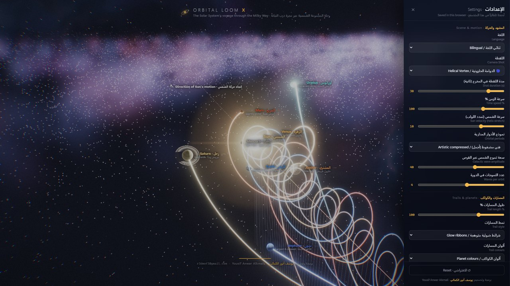

---

## 🎬 اللقطات (الأوضاع)

| # | اللقطة | الوصف |
|---|--------|-------|
| 0 | 🎬 المخرج السينمائي | يتنقل تلقائياً بين اللقطات بحركة كاميرا ناعمة |
| 1 | 🌀 الدوامة الحلزونية | الكواكب ترسم لوالب خلف الشمس المندفعة |
| 2 | 〰️ المنظور الجانبي | اللوالب ممتدة مع أعمدة الارتفاع عن قرص المجرة |
| 3 | 🌌 الرحلة المجرية | درب التبانة كاملة، ومدار الشمس المتموج، وعلامات الانقراضات الخمس الكبرى |
| 4 | ⚫ الثقب الأسود A* | انحناء ضوئي محسوب (Ray-marching) وقرص تراكم بتأثير دوبلر |
| 5 | 🫧 الغلاف الشمسي | الصدمة الانتهائية، وحد الغلاف، وموجة القوس، والرياح بين النجمية |
| 6 | 🕸️ نسيج الزمكان | بئر جاذبية الشمس والكواكب تدور على مداراتها داخله |
| 7 | 🎥 كاميرا حرة | تحكم كامل بالماوس |
| 8 | ✦ النجم الطارق (النابض) | نجم نيوتروني يدور وتكنس حزمتاه الفضاء. أربعة نوابض حقيقية من 1.4 إلى 716 دورة في الثانية |
| 9 | 🔴 ترابيست-1 | سبعة كواكب بحجم الأرض حول قزم أحمر، والمنطقة الصالحة للحياة، ومدار عطارد للمقارنة |
| 10 | 💥 كيلونوفا | نجمان نيوترونيان يقتربان حلزونياً، وأمواج الجاذبية على نسيج الزمكان، ثم الاندماج |
| 11 | ☯ ثلاثة ثقوب سوداء | مسألة الأجسام الثلاثة: محاكاة فوضوية حقيقية تتغير في كل مرة |
| 12 | 🕳 العملاق TON 618 | الكاميرا تبتعد من المجموعة الشمسية حتى يظهر الثقب الأسود كاملاً بمقياس حقيقي |
| 13 | 📏 موكب الأحجام | الأحجام الحقيقية للكواكب والشمس جنباً إلى جنب |

| | |
|---|---|
| 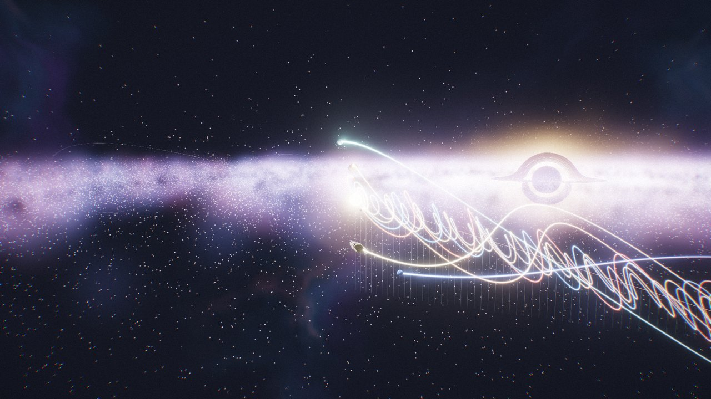 | 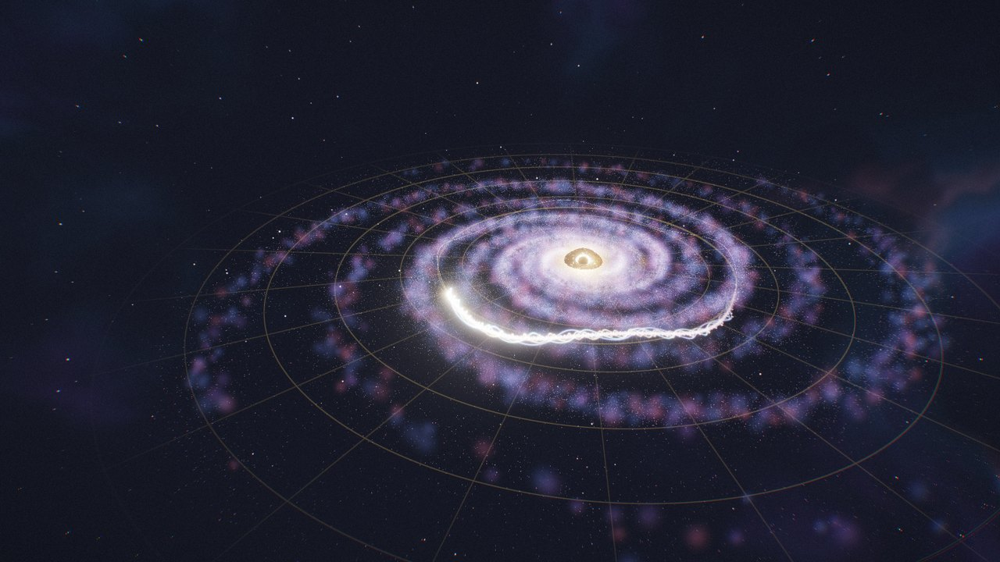 |
| 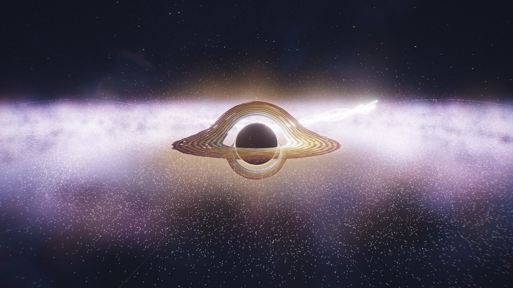 | 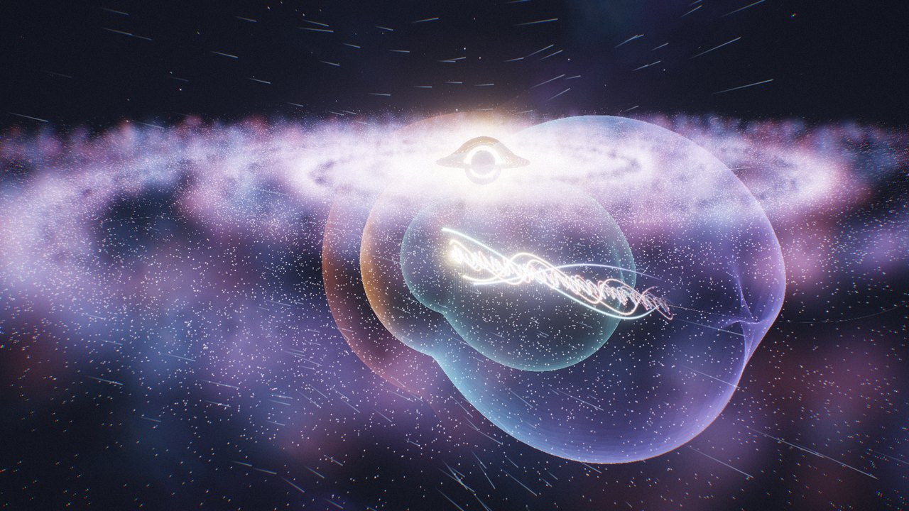 |
| 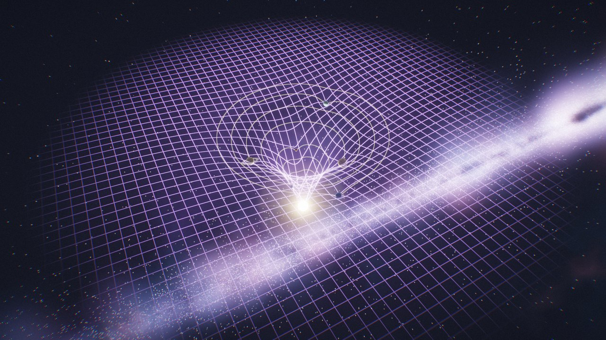 | 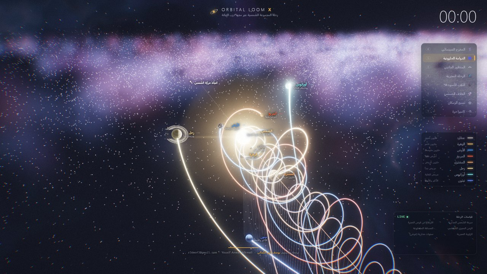 |

## 🖱️ التحكم

| الإجراء | الوظيفة |
|---|---|
| سحب الماوس | تدوير الكاميرا |
| عجلة الماوس | تقريب أو إبعاد |
| نقر على كوكب | تتبّعه بالكاميرا |
| نقرتان | إعادة ضبط الكاميرا |
| `0`–`7` | تغيير اللقطة |
| `Space` | إيقاف الزمن مؤقتاً |
| `H` / `L` | إخفاء الواجهة أو الأسماء |
| `S` | فتح الإعدادات أو إغلاقها |
| `[` `]` | المشهد السابق أو التالي (يشمل القصص) |
| `V` / `M` / `E` / `F` | العين / الصوت / التصدير / ملء الشاشة (نسخة الويب) |
| `←` `→` / `Esc` | التنقل بين الكواكب أو إلغاء التتبع |

## ⚙️ نصائح الأداء
- **الأداء التلقائي** مفعّل افتراضياً: إذا هبطت السلاسة يخفض دقة الرسم قليلاً ثم يرفعها عند توفر القدرة.
- **4K:** على شاشة 4K تُرسم الخلفية بدقتها الكاملة. وعلى شاشة أقل يمكنك رفع **دقة الرسم %** حتى 200 للحصول على صورة أنعم (تحتاج كرت شاشة قوياً).
- إذا كان الجهاز ضعيفاً: من Customize قلل **دقة الرسم %** إلى 60–75، واختر الجودة **اقتصادي**، وحد **30 FPS**.
- Lively يوقف الخلفية تلقائياً عند تشغيل لعبة أو برنامج بملء الشاشة. يمكنك ضبط ذلك من Settings ← Performance.
- تحتاج الخلفية **WebGL2**، وهو متوفر في أي كرت شاشة حديث مع تعريفات محدثة.

---

## 📥 Install & Run (English)

1. Install **Lively Wallpaper** (free) from the [Microsoft Store](https://apps.microsoft.com/detail/9ntm2qc6qws7) or [GitHub](https://github.com/lively-community/lively/releases).
2. Download **[Orbital_Loom_X_Galactic_Voyage.zip](https://github.com/r3dmof3-cyber/Orbital_Loom_X/raw/main/release/Orbital_Loom_X_Galactic_Voyage.zip)**. Don't extract it.
3. In Lively, click **➕ Add Wallpaper**, then **Choose a file**, and pick the ZIP. You can also drag and drop it into the Lively window.
4. Click the wallpaper to apply it. Open **⋯ → Customize** for 30+ options.
5. For mouse interaction, go to **Settings → Wallpaper → Wallpaper Input → Mouse**.

**No download?** In Lively's *Enter URL* box, paste `https://r3dmof3-cyber.github.io/Orbital_Loom_X/`. This needs an internet connection.

**Browser only, without Lively:** open https://r3dmof3-cyber.github.io/Orbital_Loom_X/ in any modern browser, or open `index.html` from the extracted folder. Press **F11** for fullscreen.

### ⚙️ On-screen settings
Click the **⚙** button under the clock to open a side panel with **every** option from Lively's Customize panel. Changes apply instantly and are saved in your browser. **↺ Reset** restores the defaults, **`S`** toggles the panel, and `?settings=1` opens it on load. The panel is part of the web build; the Lively wallpaper uses Lively's own Customize panel.

### What's new in 2.0
- **Six cosmic stories:** a pulsar with four real spin rates, TRAPPIST-1, a kilonova with gravitational waves, a chaotic three-black-hole simulation, a true-scale zoom out from the Solar System to TON 618, and a parade of true planet sizes.
- **Phone layout:** the live site switches to a portrait design with a bottom scene bar, touch orbit and pinch zoom.
- **Sound (web):** a procedural soundscape per scene, pulsar ticks at their real rate, and the merger chirp. No audio files.
- **Eye button (web):** full interface → captions only → scene only.
- **Export (web):** PNG up to 4K, or a multi-scene video with burned-in captions, labels and sound, in landscape, 9:16 or square.
- **Speed:** auto performance (dynamic resolution), rendering up to 4K, and the black hole is shaded only where it is on screen.
- **Two builds:** the website has every tool; the Lively ZIP keeps the eye and sound and is configured from Lively's Customize panel.

### 2.2: detailed planets and resolution presets
- Surfaces gain detail as the camera gets close: cratered relief on Mercury and Mars, Earth's mountains, coasts, clouds and city lights, Jupiter's bands and swirling Great Red Spot, solar granulation and sunspots. All procedural, so it stays sharp at any resolution.
- **Output resolution** option: Auto (from screen and GPU class), 720p, 1080p, 1440p or 4K.
- Fixed planets being cut off at the sides when close to the screen edge.

### Features
- **Analytic helical trails.** Each planet's path, including the Sun's galactic orbit, its vertical oscillation and the 60° tilt of the ecliptic, is evaluated on the GPU every frame. The trails stay perfectly smooth at any length.
- **One continuous world.** The camera flies seamlessly from planetary close-ups out to the full ~150k-star Milky Way, with spiral arms, bar, bulge, dust lanes and nebulae.
- **Sagittarius A\*:** a ray-marched black hole with gravitational lensing, a Doppler-beamed accretion disk and a photon ring.
- **Procedural planets** with no textures: Earth's continents, clouds and city lights, Jupiter's Great Red Spot, and Saturn's rings with their shadow. Three styles: realistic, neon and holographic.
- **Heliosphere** with three layers and interstellar-wind streaks. A **spacetime fabric** gravity well.
- **Rendering and extras:**
  - HDR rendering, bloom, ACES tonemapping and a cinematic grade.
  - An automatic cinematic director.
  - Audio reactivity.
  - Arabic and English UI.
  - A clock and live telemetry.
- 100% offline, with no external libraries.

### Controls
Drag to orbit, scroll to zoom, click a planet to follow it, and double-click to reset. Keys: `0–7` shots, `Space` pause, `H` HUD, `L` labels, `S` settings, `[`/`]` previous/next scene, and on the web `V` eye, `M` sound, `E` export, `F` fullscreen, `←/→` cycle planets, `Esc` stop following.

---

## 📁 Project structure
```
index.html              page layout & HUD
style.css               glass HUD styling
shaders.js              all GLSL ES 3.00 shaders
script.js               engine: simulation, camera director, renderer, Lively bridge
stories.js              the six deep-sky stories
settings.js             on-screen ⚙ settings panel (web build only)
web.js                  toolbar: eye and sound (both builds), export and fullscreen (web only)
props.js                generated from LivelyProperties.json by tools/build.py
tools/build.py          regenerates props.js and the release ZIP
LivelyInfo.json         Lively metadata
LivelyProperties.json   Lively "Customize" options
release/                ready-to-import ZIP
docs/screenshots/       images for this README
```

To rebuild after editing, run `python tools/build.py`. It regenerates `props.js` from `LivelyProperties.json` and packs the desktop ZIP, leaving out the scripts between the `web-only` markers in `index.html`.

## 📜 License
[MIT](LICENSE). Free to use, share and modify; please keep the credit.

**© 2026 Yousif Anwar Alkmali — يوسف أنور الكمالي — r3dmof3@gmail.com**

> Scientific note: distances, sizes and time scales are artistically compressed so everything fits in one scene. The real Sun moves at ~230 km/s, a galactic year is ~230 Myr, and the ecliptic is tilted ~60° to the galactic plane.
